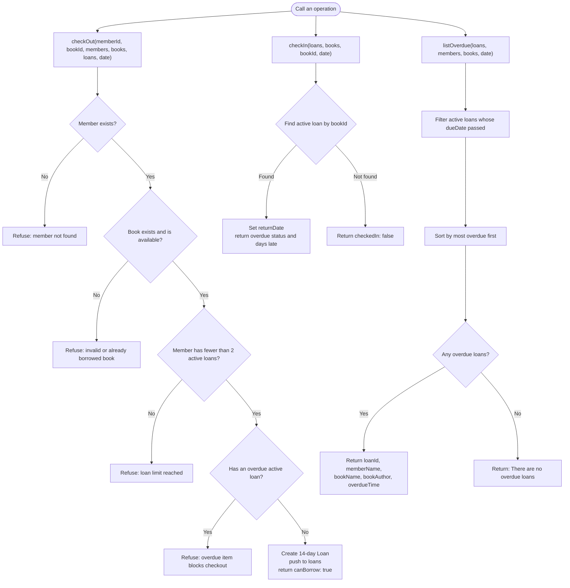

# Community Library Circulation Engine

> Checkout rules for a volunteer library, written as pure TypeScript.

**Build status:** Complete · Stage 1 · practice

**Repo:** [github.com/techbrobolu/buildpath](https://github.com/techbrobolu/buildpath) · **Project brief:** [Buildpath](https://buildpath-project-compass.lovable.app/projects/library-circulation-engine)

---

## Table of contents

- [The problem](#the-problem)
- [Who it's for](#who-its-for)
- [Features](#features)
- [Tech stack](#tech-stack)
- [Architecture](#architecture)
- [Getting started](#getting-started)
- [Testing](#testing)
- [Decision records](#decision-records)
- [Known limitations](#known-limitations)
- [What I learned](#what-i-learned)
- [Roadmap](#roadmap)
- [License and credits](#license-and-credits)

---

## The problem

The Maple Street Little Library is run by four volunteers with a shared notebook. Items get lost because nobody can tell who borrowed what, and the rules — two books at once, 14-day loans, no loans while you owe a late item — live in one volunteer's head.

This module encodes those rules so any volunteer (or any future UI) can answer: **can this person borrow this book today?**

---

## Who it's for

| Persona | Role | Core need | How this project serves them |
| --- | --- | --- | --- |
| Ines | Volunteer coordinator | Rules applied the same way on every shift | `checkOut` enforces the same loan limit and overdue block every time it's called |
| Theo | Borrower, age 12 | Know when his book is due without asking an adult | `checkOut` returns a `loan` object with `dueDate`; `checkIn` reports days late |

---

## Features

- [x] Model books, members, and loans as plain typed objects
- [x] `checkOut(memberId, bookId, members, books, loans, date)` — returns a loan or a reason it was refused
- [x] `checkIn(loans, books, bookId, date)` — closes the active loan and reports days late if overdue
- [x] `listOverdue(loans, members, books, date)` — returns all overdue loans sorted by most overdue first
- [x] Enforce: max 2 active loans per member, 14-day loan period, block checkout if any active loan is overdue

### Acceptance criteria

- [x] A member with an overdue item is refused checkout with a clear reason
- [x] Checking in a book that isn't on loan returns `{ checkedIn: false }`, not a crash
- [x] All tests pass with `npm test`

---

## Tech stack

| Tool | Purpose |
| --- | --- |
| TypeScript | Type-safe implementation of all logic |
| Vitest | Unit test runner |
| tsc | Compiles TypeScript to `dist/` |

---

## Architecture

This is a pure logic library — no server, no UI, no database. All state lives in the arrays you pass in.



**Data model:**

| Type | Key fields |
| --- | --- |
| `Book` | `id`, `name`, `author` |
| `Member` | `id`, `name` |
| `Loan` | `id`, `memberId`, `bookId`, `loanDate`, `dueDate`, `returnDate \| null`, `overdueTime?` |

---

## Getting started

### Prerequisites

- Node.js (any recent LTS)
- npm

### Installation

```bash
git clone https://github.com/techbrobolu/buildpath.git
cd buildpath
npm install
```

### Run locally

There is no server to start. Import the functions directly:

```ts
import { checkOut, checkIn, listOverdue } from "./src/index";
```

### Build

```bash
npm run build
```

Outputs compiled JS to `dist/`.

### Type check only (no emit)

```bash
npm run typecheck
```

---

## Testing

Three test files, one per exported function:

| File | What it covers |
| --- | --- |
| `src/tests/checkout.test.ts` | Valid checkout, loan limit, overdue block, nonexistent book/member |
| `src/tests/checkin.test.ts` | Successful check-in, overdue check-in, book not on loan |
| `src/tests/listoverdue.test.ts` | No overdue loans, single overdue, sorted by most overdue first |

**Run all tests:**

```bash
npm test
```

Each test file uses `beforeEach` to reset shared `books`, `members`, and `loans` arrays so tests don't bleed into each other.

---

## Decision records

### ADR-001 — Use TypeScript instead of plain JavaScript

- **Status:** Accepted
- **Context:** The project brief called for plain JavaScript, but the data shapes (Books, Members, Loans) have enough fields that typos and shape mismatches cause silent bugs.
- **Decision:** Use TypeScript with strict types for all data models and function signatures.
- **Consequences:** Adds a build step (`tsc`) and a devDependency, but catches parameter order mistakes and missing field errors at compile time rather than test time.

### ADR-002 — Pass arrays as parameters instead of using module-level state

- **Status:** Accepted
- **Context:** Could have declared `books`, `members`, and `loans` as module-level variables and imported them everywhere.
- **Decision:** Every function takes the arrays it needs as parameters.
- **Consequences:** Functions are pure and easy to test in isolation — no need to reset module state between tests. Slight verbosity in call sites.

### ADR-003 — Use ISO string dates instead of `Date` objects

- **Status:** Accepted
- **Context:** Passing `Date` objects around leads to mutation bugs and serialization pain.
- **Decision:** All date fields are ISO strings; date math is done inline using `.getTime()`.
- **Consequences:** Explicit and serialization-safe, but requires `new Date(str).getTime()` at every comparison point.

---

## Known limitations

- Loan IDs are generated as `String(loans.length + 1)` — not safe if loans are ever deleted from the array.
- `Book.isBorrowed` was removed in favour of checking active loans directly; the two sources of truth that existed earlier have been collapsed into one.
- No persistence — all state is lost when the calling context is gone.
- No reservations (holds) or per-item loan periods.

---

## What I learned

### Learning goals

- Design data shapes before writing logic
- Write small pure functions that are easy to test
- Return structured results instead of logging strings
- Use the debugger to step through a failing rule

### Reflections after building

- Writing the types first forced real decisions about what data each function needed — several bugs (wrong parameter order, missing fields) were caught at the type level before tests even ran.
- Filtering active loans with `returnDate === null` was the key guard. Missing it caused returned loans to still count toward the checkout limit.
- `beforeEach` resets make tests genuinely independent. The earlier version with `afterEach` mutation cleanup was fragile.
- Returning structured objects (`{ canBorrow, reason?, loan? }`) from every function made tests straightforward to write and would make a future UI easy to wire up.

---

## Roadmap

### Stretch goals

- [ ] Add reservations (holds) with a first-come queue
- [ ] Support different loan periods per item type (e.g. DVDs: 7 days)
- [ ] Persist state to a JSON file or simple database
- [ ] CLI or small web UI for volunteers to interact with

---

## License and credits

ISC · Built as part of [Buildpath](https://buildpath-project-compass.lovable.app) — a self-directed project learning tracker.
